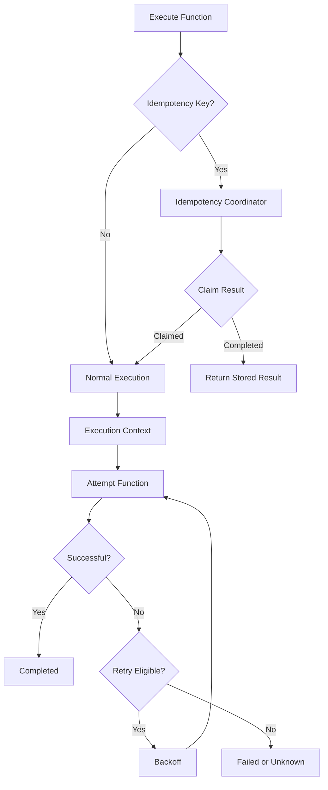

# Execution Engine

The AgentGuard Execution Engine is responsible for managing the lifecycle of function execution. It provides a controlled execution environment with retry policies, backoff strategies, deadlines, attempt timeouts, execution context tracking, and optional idempotency and recovery integration.

The Engine does not simply call a function. It manages how that function is executed, how failures are handled, and how execution outcomes are recorded.

## Overview

The Engine acts as the central execution component of AgentGuard.

It is responsible for:

- Executing registered functions.
- Managing execution attempts.
- Applying retry policies.
- Applying backoff strategies between attempts.
- Enforcing overall execution deadlines.
- Detecting attempt timeout violations.
- Tracking execution context and state transitions.
- Integrating with idempotency coordination.
- Integrating with recovery workflows.

The Engine is designed to separate execution orchestration from function implementation and storage concerns.

## Basic Execution Flow

When a function is submitted to the Engine, the Engine retrieves it from the function registry, validates the execution configuration, and executes it under the configured policy.



## Normal Execution

Normal execution is the execution path used when no idempotency key is supplied.

```python
result = engine.execute(
    "fetch_data",
    url,
    timeout=30,
)
```

The Engine:

1. Retrieves the registered function.
2. Validates execution configuration.
3. Creates an execution context.
4. Establishes the execution deadline.
5. Executes the function.
6. Evaluates failures against the retry policy.
7. Applies backoff when retrying.
8. Updates execution state.
9. Returns the result or raises the final exception.

Normal execution is focused on controlling a function's execution lifecycle within the current process.

## Execution Policies

An execution policy defines how the Engine handles failed execution attempts.

```python
from agentguard import ExecutionPolicy

policy = ExecutionPolicy(
    max_attempts=3,
    retry_on=(ConnectionError,),
)
```

### `max_attempts`

Defines the maximum number of attempts the Engine may perform for a single execution.

A value of `3` means the Engine may execute the function up to three times, including the initial attempt.

### `retry_on`

Defines the exception types eligible for retry.

The Engine does not retry every exception automatically. Retry eligibility is explicitly determined by the configured policy.

This allows applications to distinguish transient failures from permanent failures.

## Backoff Policy

Backoff controls the delay between eligible execution attempts.

```python
result = engine.execute(
    "fetch_data",
    url,
    policy=policy,
    backoff=backoff,
)
```

Backoff is independent of retry eligibility.

The execution policy determines whether another attempt is allowed. The backoff policy determines the delay before that attempt.

This separation allows retry behavior and retry timing to be configured independently.

## Execution Deadlines

An execution deadline limits the total amount of time an execution may consume.

```python
result = engine.execute(
    "fetch_data",
    url,
    timeout=30,
)
```

The Engine uses a monotonic clock to track elapsed execution time.

A monotonic clock is used because wall-clock time can change due to clock synchronization, system adjustments, or other external factors.

The deadline is evaluated throughout the execution lifecycle, including retry delays.

## Attempt Timeouts

An attempt timeout limits the duration allowed for an individual attempt.

```python
result = engine.execute(
    "fetch_data",
    url,
    attempt_timeout=10,
)
```

An attempt timeout differs from an overall deadline:

| Timeout | Purpose |
|---|---|
| `timeout` | Limits the overall execution lifecycle |
| `attempt_timeout` | Limits the allowed duration of an individual attempt |

AgentGuard's synchronous execution model detects timeout violations but does not forcibly terminate arbitrary Python functions running in the same thread.

Applications that require hard termination boundaries should execute functions inside independently managed processes or external workers.

## Execution Context

Each execution is associated with an execution context.

The context tracks execution-related information throughout the lifecycle, including state and timing information.

It provides a structured representation of execution rather than relying solely on the function's return value or raised exception.

Execution state is managed through explicit transitions rather than arbitrary state assignment.

## Idempotent Execution

The Engine can integrate with an IdempotencyCoordinator to manage idempotent execution.

```python
result = engine.execute(
    "charge_customer",
    customer_id,
    idempotency_key="payment-123",
)
```

When an idempotency key is supplied, the Engine delegates operation ownership and claim decisions to the IdempotencyCoordinator.

The operation may be:

- Already completed, in which case the stored result is returned.
- Successfully claimed, in which case execution proceeds.
- Currently owned by another execution, in which case execution cannot proceed under the current claim.
- In a state requiring recovery or further coordination.

The coordinator and backend are responsible for enforcing operation ownership, mutation authority, and durable operation state.

The Engine does not independently determine whether an operation is safe to execute concurrently.

See [Idempotency](../idempotency/overview.md) for the full idempotency lifecycle.

## Recovery Integration

The Engine supports recovery integration through a RecoveryEngine.

Recovery is separate from normal execution. Recovery investigates an uncertain operation and determines whether it can be completed, resumed, deferred, or requires manual intervention.

```python
outcome = engine.recover(
    operation_id,
)
```

The Engine delegates recovery orchestration to the RecoveryEngine.

Recovery handlers are application-specific. AgentGuard does not automatically assume that an uncertain function can safely be re-executed.

A recovery decision may result in:

- `COMPLETED`: The operation is reconciled as completed.
- `RESUME`: Execution is handed back to the normal execution lifecycle.
- `DEFER`: Recovery is postponed.
- `MANUAL_INTERVENTION`: Automatic recovery is stopped.

See [Recovery](../recovery/overview.md) for the full recovery model.

## Execution Boundaries

AgentGuard manages execution orchestration, but it does not guarantee that arbitrary external side effects can be reversed or safely repeated.

The Engine cannot independently guarantee:

- Termination of arbitrary synchronous Python functions.
- Rollback of external side effects.
- Exactly-once execution of external systems.
- Safe replay of arbitrary functions.
- Recovery of an arbitrary Python stack or process memory.

These guarantees depend on application-level design, external system capabilities, idempotency mechanisms, and recovery logic.

## Design Principles

The Engine follows several design principles:

- **Explicit policies:** Retry behavior is configured rather than assumed.
- **Separation of concerns:** Execution, idempotency, recovery, and storage are separate components.
- **Controlled state transitions:** Execution state is managed through defined transitions.
- **Time-based control:** Execution deadlines use monotonic time.
- **Explicit recovery:** Uncertain operations are reconciled through application-defined recovery logic.
- **No implicit replay:** AgentGuard does not blindly retry uncertain operations.
- **Backend authority:** Durable operation mutation and ownership enforcement belong to the backend and coordination layer.

The Execution Engine provides the execution orchestration foundation upon which AgentGuard's idempotency and recovery capabilities are built.