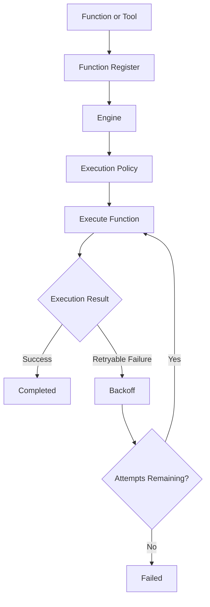

# AgentGuard

**A reliability and execution control layer for Python functions and AI agent tools.**

AgentGuard brings controlled, observable and resilient execution to Python functions, API calls and AI agent tool invocations.

Instead of allowing functions to execute without safeguards, AgentGuard provides a centralized execution layer with configurable execution policies, retries, backoff strategies, execution lifecycle tracking and deadline awareness.

AgentGuard is designed to help developers build more reliable systems around functions, external APIs and AI agent tools.

---

## Why AgentGuard?

AI agents and application systems frequently interact with unreliable external services, APIs, databases and tools.

A function call may fail because of:

- Temporary network failures
- API rate limits
- Service outages
- Unexpected exceptions
- Slow or unresponsive dependencies

Handling these failures independently in every application creates duplicated logic, inconsistent retry behavior and difficult-to-observe execution flows.

AgentGuard centralizes these execution concerns into a reusable execution layer.

Rather than implementing retry logic, execution tracking and failure handling separately for every tool, developers can register functions and execute them under configurable policies.

---

## Features

### Currently implemented

- **Function Registry** — Register, retrieve and manage functions.
- **Execution Context** — Track execution IDs, status, attempts, timestamps and execution metadata.
- **Execution Lifecycle** — Manage execution state transitions.
- **Execution Policies** — Configure retry limits and retryable exceptions.
- **Retry Engine** — Automatically retry eligible failures.
- **Backoff Strategies** — Exponential backoff with configurable limits and jitter.
- **Retry History** — Record exceptions and retry decisions.
- **Deadline Awareness** — Track execution time budgets.
- **Timeout Configuration** — Configure execution and per-attempt timeout parameters (under development).

### Planned

- Idempotency
- Circuit breakers
- Async execution
- Async retry and cancellation
- Concurrency control
- Child executions and execution trees
- Observability and metrics

---

## Installation

Install AgentGuard directly from PyPI:

```bash
pip install agentguard
```

### Verify installation

```python
import agentguard

print("AgentGuard installed successfully")
```

---

## Examples

AgentGuard includes examples demonstrating how the library can be integrated into real-world workflows.

### Resilient API Call

Demonstrates how AgentGuard can protect an API call with execution policies and retry behavior.

**Concepts:**

- Function registration
- Execution policies
- Retryable exceptions
- Backoff strategies
- Controlled execution

```text
examples/resilient_api_call/
```

### AI Research & Report Generation Agent

A multi-step AI research workflow that uses external tools to search for information, retrieve sources, analyze evidence and generate a research report.

**Workflow:**

1. Receive a research request.
2. Search for relevant sources.
3. Retrieve source content.
4. Analyze and synthesize information.
5. Generate a structured research report.
6. Save the report.

**Concepts:**

- Agent tool execution
- Function registration
- Execution policies
- Retry behavior
- Backoff strategies
- Execution tracking
- External API integration
- Failure handling

```text
examples/ai_research_agent/
```

### GitHub Issue Triage Agent

An AI-powered workflow that retrieves GitHub issues, analyzes them and applies triage actions using the GitHub API.

**Workflow:**

1. Fetch issue information.
2. Analyze the issue.
3. Propose labels and a triage summary.
4. Apply approved changes.
5. Post a triage comment.

**Concepts:**

- External API integration
- Agent tool execution
- Retry handling
- Execution policies
- Controlled external operations

```text
examples/github_issue_triage/
```

---

## Architecture

AgentGuard is designed around a separation of concerns.

| Component         | Responsibility                                 |
| ----------------- | ---------------------------------------------- |
| Function Register | Stores and retrieves executable functions      |
| Execution Context | Tracks an individual execution                 |
| Execution Policy  | Defines retry eligibility and attempt limits   |
| Backoff Policy    | Calculates retry delays                        |
| Engine            | Orchestrates execution, validation and retries |

### Execution flow



---

## Getting Started

Explore the examples to understand how AgentGuard can be integrated into your Python applications and AI agent workflows.

Start with:

```text
examples/resilient_api_call/
```

Then explore the multi-tool workflow:

```text
examples/ai_research_agent/
```

---

## Project Status

AgentGuard is in early development.

Interfaces and implementation details may change as the project evolves.

AgentGuard is currently focused on controlled function execution, execution lifecycle management, retry policies, backoff strategies and execution tracking.

Features such as idempotency, circuit breakers, asynchronous execution and advanced concurrency control are planned for future development.

AgentGuard is not yet recommended for critical production workloads.

---

## License

AgentGuard is licensed under the MIT License.

See [LICENSE](LICENSE) for details.
